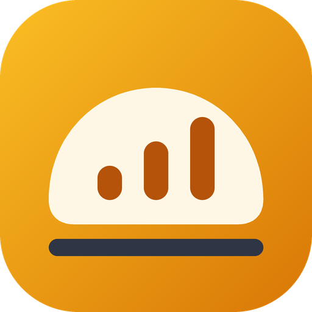
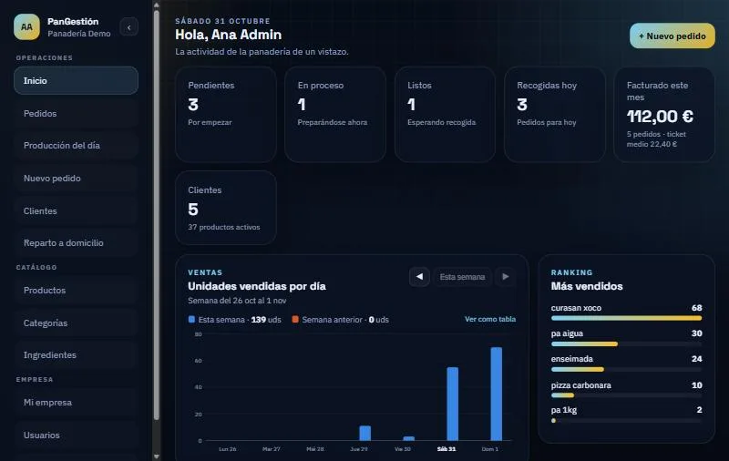
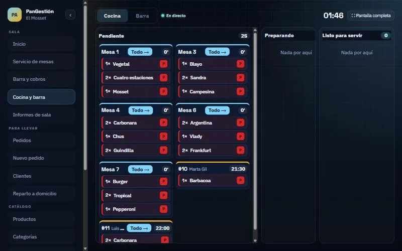

  

<h1 align="center">PanGestión</h1>

  <b>Pedidos online, obrador, sala, cocina y reparto de una panadería o un bar, en una sola app.</b> 
  <a href="https://quiquealonso.github.io/PanGestion/">Web del producto</a> ·
  <a href="https://quiquealonso.github.io/PanGestion/app/">App</a> ·
  <a href="docs/desarrollo.md">Desarrollo</a> ·
  <a href="docs/despliegue.md">Despliegue</a>

---

## Qué es

PanGestión es una aplicación web para gestionar el día a día de **panaderías, obradores, bares y restaurantes**.
Sustituye la libreta de encargos, el WhatsApp, las comandas en papel y las cuentas en la calculadora:

- **Los clientes** piden desde el móvil, eligen hora de recogida o entrega a domicilio y ven qué lleva cada producto.
- **El obrador** sabe cuánto tiene que hacer de cada producto y para qué hora.
- **La sala** trabaja con el plano de mesas en el móvil del camarero.
- **La cocina y la barra** reciben cada comanda al instante en su pantalla.
- **El repartidor** ve en su móvil qué tiene que llevar y adónde.
- **El dueño** ve ventas, productos más vendidos y la caja del día.

Todo funciona en el navegador (móvil, tablet u ordenador) y se puede instalar como una app sin pasar por ninguna tienda de aplicaciones.

  
  

## Qué hace

### Para panaderías y obradores

| | |
|---|---|
| **Web de pedidos propia** | El cliente elige local, productos y hora de recogida. Puede quitar ingredientes («sin cebolla») o añadir extras con precio. |
| **Franjas con aforo** | Recogida por franjas (cada 30 o 60 min) con un máximo de pedidos por franja: no se aceptan más de los que se pueden preparar. |
| **Producción del día** | Tabla de producto × franja horaria que se actualiza sola con cada pedido; pensada para la pantalla del obrador. |
| **Pedidos** | Por día y por estado (pendiente → en proceso → listo → entregado), con descarga de lo que hay que preparar. |
| **Carta** | Productos con foto, precio, ingredientes, alérgenos, extras y orden de preparación. |
| **Clientes y ventas** | Ficha de cada cliente con sus pedidos y su gasto, ventas por día comparadas con la semana anterior y ranking de productos. |

### Para bares y restaurantes

| | |
|---|---|
| **Plano de la sala** | Editor visual por zonas (interior, terraza…) con mesas redondas, cuadradas, alargadas y taburetes. |
| **Camarero en el móvil** | Abre mesas (y las junta), apunta rondas y ve en vivo qué mesas están ocupadas. |
| **Cocina y barra en directo** | Pantallas táctiles con cada comanda: pendiente → preparando → listo. Cada producto va a quien lo prepara. |
| **Avisos** | Cuando algo está listo, al camarero le suena y le vibra el móvil; el repartidor recibe aviso de lo que hay que llevar. |
| **Cobro** | Efectivo (con el cambio) o tarjeta, cuenta a medias o por comensal, precuenta y caja del día. |
| **Reparto a domicilio** | Pedidos con dirección; el repartidor marca «me lo llevo» y «entregado» desde su móvil. |
| **Informes de sala** | Facturación, ticket medio, horas punta, más vendidos, camareros, mesas y tiempos de cocina. |

### Para todos

- **Roles:** administrador, encargado, solo lectura, camarero, cocina y repartidor. Cada uno ve solo lo que necesita.
- **Varios negocios:** cada local tiene su carta, sus horarios, su logo, su equipo y sus datos, separados de los demás.
- **App instalable (PWA):** se avisa en el móvil para instalarla, y cada actualización llega con un botón «Actualizar».
- **Modo claro y oscuro.**

## Seguridad

- Los datos personales de los clientes (teléfono, CIF y dirección) se guardan **cifrados con AES-256**, y las contraseñas, con BCrypt.
- Todo viaja por **HTTPS**, con cabeceras de seguridad, límite de intentos de login y protección contra bots.
- Los servidores están en **Google Cloud, en Madrid**. Antes de cada actualización se hace una copia de la base de datos.
- Cada cambio pasa **cientos de tests automáticos** y escaneos de secretos y dependencias antes de publicarse.

Las reglas de seguridad, con cómo se cumple cada una y qué la comprueba, están en [docs/reglas-seguridad.md](docs/reglas-seguridad.md).

## Cómo está hecho

| Parte | Tecnología |
|---|---|
| Frontend | Angular 22 (PWA), publicado en GitHub Pages |
| Backend | Java 21, Spring Boot 4, Spring Security (JWT), Spring Data JPA |
| Base de datos | PostgreSQL 17 (H2 en desarrollo) |
| Servidor | VM de Google Cloud con Docker y Caddy (HTTPS automático) |
| Tiempo real | Server-Sent Events (cocina, sala y avisos) |
| CI/CD | GitHub Actions: tests en cada push, despliegue automático al fusionar en `main` |

## Documentación

| Documento | Contenido |
|---|---|
| [docs/desarrollo.md](docs/desarrollo.md) | Ponerlo en marcha en local, usuarios de prueba, compilar y probar, estructura |
| [docs/despliegue.md](docs/despliegue.md) | Producción, CI/CD, app instalable, cuentas de cliente y correo |
| [docs/reglas-seguridad.md](docs/reglas-seguridad.md) | Reglas de seguridad y cómo se comprueban |
| [docs/pendientes.md](docs/pendientes.md) | Lo que queda por hacer |
| [backend/README.md](backend/README.md) | Modelo de datos, reglas de negocio y endpoints de la API |
| [context.md](context.md) | Contexto del proyecto y decisiones tomadas |
